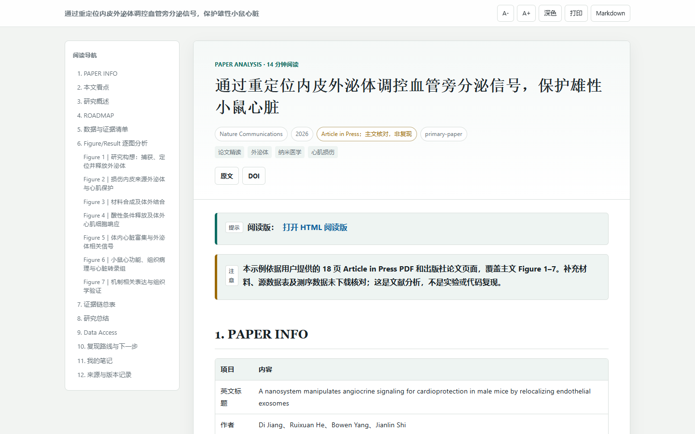

# 用 Codex 精读论文

> 🛒 **ChatGPT Plus 代充**：有订阅需求的朋友，可以前往 [AI 小铺查看商品](https://www.16688.com.cn/goods/G48245027)。
>
> 🛠️ **AI 配置服务**：需要搭建 AI 工作环境、配置 Codex 或接入 API？欢迎联系我交流需求，微信：`18581258631`。
>
> 以上为作者提供的第三方服务，具体商品及服务内容以页面和沟通为准。

一个面向 Codex 的生物医学和生信论文分析 skill：快速了解论文，或按 Figure/Result 逐图精读；将分析中使用的论文原图嵌入 Markdown 笔记和 HTML 阅读版，区分数据观察、计算推断和实验验证。

**带图是核心交付要求：**完整精读覆盖全部主图；快速了解嵌入所选的关键图。可以从出版社原图或用户提供的 PDF 中获取。如果图片确实无法取得或验证，结果会标明缺图及原因，不能称为完成带图精读。

交付前会对照论文图号清单运行本地验证，检查图片文件及 Markdown、HTML 中的嵌入情况，输出逐图报告。自动检查不能代替核对论文中原图是否正确、图号清单是否完整，也不能代替浏览器实际加载检查。

## HTML 阅读版预览

下图展示论文精读笔记的 HTML 阅读版首页，包含目录、论文信息和阅读提示。



## 第一次安装

先安装 [Node.js](https://nodejs.org/) **22.20 或更新版本**。这是当前 `skills` 安装工具的要求；随包 HTML 渲染器的要求是 Node.js 20 或更新版本。

打开终端：Windows 同时按下 `Win + R`，输入 `PowerShell` 并按回车；Mac 打开“终端”。运行以下命令检查版本：

```bash
node --version
npx --version
```

然后运行：

```bash
npx --yes skills add https://github.com/Han-Z02/hz-paper-analysis/tree/main/skills/hz-paper-analysis -g -a codex --copy -y
```

这条命令通过第三方 `skills` CLI 从 GitHub 安装到当前用户的 Codex。Windows PowerShell、macOS 和 Linux 都可以使用。安装后新开一个 Codex 对话即可调用。

安装只需做一次；以后使用时直接打开 Codex 即可。

确认安装：运行 `npx skills list -g`，检查列表是否包含 `hz-paper-analysis`。当前安装器的 Codex 全局目录为 `~/.agents/skills/hz-paper-analysis/`（Windows：`%USERPROFILE%\.agents\skills\hz-paper-analysis\`）；安装器版本不同可能有变化，以命令输出为准。随后新开 Codex 对话，附上论文并用下面的提示词试用。

更新由 `skills` CLI 安装并追踪的 skill：

```bash
npx --yes skills update hz-paper-analysis -g -y
```

## 使用

在 Codex 中附上论文 PDF，或提供 DOI/文章链接。先快速了解时输入：

```text
用 $hz-paper-analysis 快速了解这篇论文，标明已读范围、关键证据和未核对内容。
```

需要完整逐图时输入：

```text
用 $hz-paper-analysis 逐图精读这篇论文，生成 Markdown 和 HTML 阅读版。
```

未指定分析范围时默认完整精读。快速了解嵌入选入分析的关键图，完整精读清点并嵌入全部主图；缺少原文、补充材料或图片时，结果会列出缺口。

默认输出到当前项目/工作区下的 `paper-analysis/<论文短标题>/`，包括 Markdown、HTML、图片清单、验证报告和按需生成的 `images/`。移动或分享分析结果时，请保留整个论文文件夹。

## 安装与使用排查

| 情况 | 先检查什么 |
|---|---|
| `node` 或 `npx` 找不到 | 安装 Node.js 后重新打开终端，运行上面的版本命令；确认版本符合安装工具要求。 |
| 安装失败或无法连接 GitHub | 检查终端网络和 GitHub 访问；保留错误信息，必要时使用下方手动安装。 |
| Codex 没识别到 skill | 检查安装器输出的目录及其中的 `SKILL.md`，重新打开 Codex 并新建对话；手动安装时检查下方指定目录。 |
| 论文链接能打开，但分析缺图或缺内容 | 原文、补充材料和高清图可能需要访问权限；提供有权使用的 PDF 或补充材料，查看结果中的未完成项。 |
| HTML 没生成 | 检查 Node.js 可用性及渲染器报错，确认 Markdown 和 skill 的 `scripts/` 目录存在。 |

寻求帮助时优先提供报错信息和操作步骤；分享日志前先移除论文全文、个人信息、密钥和其他敏感内容。

## 包含内容

- `skills/hz-paper-analysis/SKILL.md`：执行流程与验收标准
- `skills/hz-paper-analysis/references/`：精读模板、证据分级规则
- `skills/hz-paper-analysis/scripts/render_note_html.mjs`：随包提供的 HTML 渲染器
- `skills/hz-paper-analysis/scripts/validate_note.mjs`：根据图号清单检查带图交付
- `skills/hz-paper-analysis/scripts/vendor/`：渲染器所需的 Marked；许可见同目录文件

README 中的演示仅展示 HTML 阅读版首页截图。skill 默认在本机工作区生成阅读材料，不会自动发布分析结果。

## 使用条件与边界

- 生成 HTML 需要 Node.js 20 或更新版本；不需要额外安装 npm 依赖。
- 完整逐图分析需要能读取论文正文和补充材料。
- 获取高分辨率原图需要可用的浏览器或 PDF 工具；付费墙、403 或网络限制可能导致某些图片无法取得。skill 会报告缺口，不会用猜测补齐。
- 本仓库没有为 skill 说明和模板单独指定许可证。随包的 Marked 组件按其独立 MIT 许可证提供。
- 论文原图版权归原权利人。生成的笔记、PDF 和原图不会自动推送到 GitHub。
- 文件保存在本机不代表处理过程完全离线：内容是否发送给模型服务或其他工具取决于所用平台和配置。处理未发表论文或敏感资料前，请确认所用服务的设置及使用权限。

## 手动安装

也可以克隆仓库，把 `skills/hz-paper-analysis/` 整个文件夹复制到 Codex 个人技能目录：

- Windows：`%USERPROFILE%\.codex\skills\hz-paper-analysis\`
- macOS/Linux：`~/.codex/skills/hz-paper-analysis/`

手动复制的版本需要手动更新；避免在多个技能目录同时安装同一 skill，以免出现重复项。
